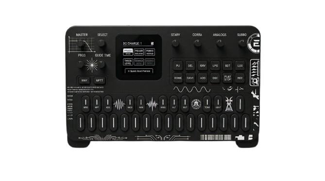


# Tekno FM-1 Jiant Rework

> **A small patch for JIANT FM** — six techno-family genres replacing generic world/jazz/hip-hop slots.

**Based on**: [JIANT FM](https://github.com/juanjiant-bit/JIANT) v0.9.18  
**Patch by**: MarcoCasanova00  
**Original authors**: Juan Jiant (Juan Ignacio Antonucci), Hügelton Instruments (Felucca)

## What Changed (Replaced)
| Removed (original) | Replaced with |
|--------------------|---------------|
| BROKEN | PSY TRANCE |
| AFROBEAT | TEKNO |
| BOSSA | MENTAL TEKNO |
| JAZZ | ACID CORE |
| BOOM BAP | HARDTEKK |
| STEPPERS | TRIBE TEKNO |

All original 43-genre count preserved — each new genre occupies a slot vacated by the removed ones. PSY TRANCE sits in the old BROKEN slot (42), so genre indices 0–42 remain stable.

- **11 new generator recipes** tuned for techno tempos, kick/bass interaction, accent displacement, and polymeter
- **8 new playable ANALOG presets**: TRIBE BASS, TEKK BASS, PSY BASS, CORE 303, TEKK STAB, PSY LEAD, TEKNO BASS, MENTAL RING
- **6 new drum maps** with genre-specific kick patterns, hi-hats, percussion
- **6 new bass archetypes** designed against the new kick rules

## Try It
- **Browser Emulator**: [https://MarcoCasanova00.github.io/JIANT/emu/](https://marcocasanova00.github.io/JIANT-tekno-rework/)

## How Genre Generation Works
1. Navigate to the generator: on HOME, tap **HOME** to cycle groups to **GEN 1**, or hold **HOME** and turn **SELECT**.
2. **KNOB 1** (or **PRESETS**) chooses the genre. Turning the knob updates the screen but does **not** regenerate music immediately.
3. Press **OCT+** (or keyboard `]` / `+`) to **commit and generate** the piece.
4. **Seed Persistence**: When you switch genres, JIANT intentionally preserves the current **SEED** so you can hear the same composition re-orchestrated under the new genre's synth patches and tempo range. Because tekno genres (Tekno, Acid Core, Hardtekk) share 4-on-the-floor kicks and modal progressions, keeping the same seed will produce similar sequence notes. **To generate a completely fresh sequence and new seed, simply press OCT+ a second time.**

## Flashing & Device Safety
- **Coming from another custom firmware (Felucca, baudgirl, Skiff)**: **You MUST roll back to official V15 first** before installing JIANT. Writing JIANT directly over a different custom firmware will brick the FM-1 due to differing flash partition tables.
- **Coming from stock JIANT (v0.9.x) or official V15**: Safe to install directly via the web installer. The package preserves the exact identity (`FM-1_900`) and partition layout, and leaves 14,892 B of verified free headroom in the app slot without modifying the hardware bootloader.
- **Recovery**: If a flash is interrupted mid-transfer, the FM-1 enters `WL80UBOOT` recovery mode and can be cleanly re-flashed without opening the hardware.

## Documentation
- [README-PAGES.md](README-PAGES.md) - How to enable and host the emulator on GitHub Pages
- [docs/TODO-EXPORT-TO-STOCK.md](docs/TODO-EXPORT-TO-STOCK.md) - Specification and roadmap for exporting generated projects to stock FM-1

## License
GPL-3.0-only

This is a patch/modification of the original JIANT FM project. The underlying firmware is © 2026 Juan Ignacio Antonucci (Juan Jiant), based on Felucca 1.1.5.1 by Hügelton Instruments. This patch contains the original license and copyright notices.

**Attribution**: This patch is distributed in the hope that it will be useful, but WITHOUT ANY WARRANTY; without even the implied warranty of MERCHANTABILITY or FITNESS FOR A PARTICULAR PURPOSE. Use at your own risk on hardware.
